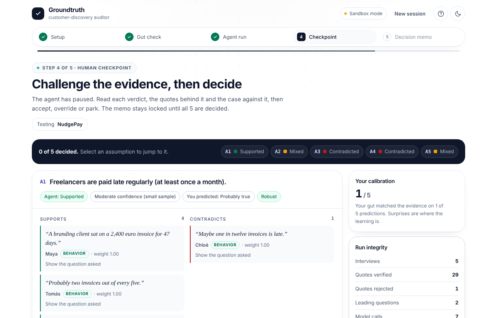
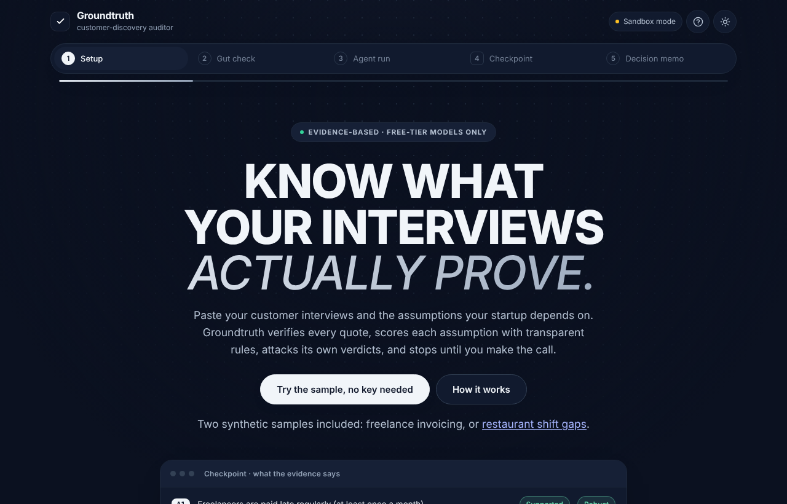
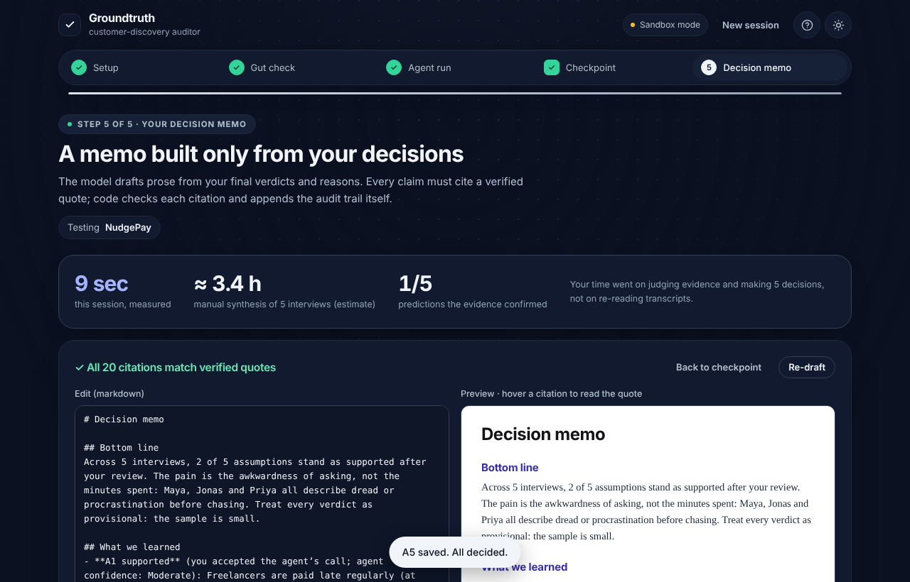
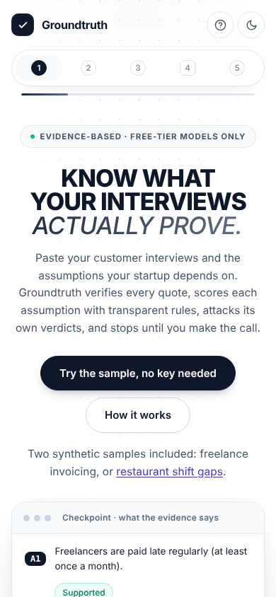

# Groundtruth

**An AI agent that audits a founder's customer interviews before they bet the company on them.**

Early-stage founders run 5 to 20 discovery interviews, then spend half a day turning them into a story. The story is usually the one they hoped for. Groundtruth reads the transcripts and keeps only quotes it can prove were said. It tests the founder's riskiest assumptions with transparent rules, argues against its own verdicts, and coaches the founder on their interviewing. Then it **stops**: nothing becomes a decision, and no memo exists, until the founder has challenged every verdict.

Built for the HETIC *AI Agents for Founders* challenge (2026). Runs only on free-tier or open-weight models. No backend, no build step, no dependencies.



| Landing (dark) | Decision memo (dark) | Phone (light) |
|---|---|---|
|  |  |  |

## Try it in 30 seconds

Open `index.html` or the live site at https://mdifteeraiyan.github.io/groundtruth/ and click **Try the sample, no key needed**. For the full walkthrough, from first run through deployment, video and Devpost, see **[HOW_TO_USE.md](HOW_TO_USE.md)**.

## What it does

| Step | Who | What happens |
|---|---|---|
| 1. Setup | You | Paste or upload transcripts, write 3 to 8 riskiest assumptions, pick a model |
| 2. Gut check | **You** | Predict each assumption *before* the agent speaks. Predictions lock once it runs |
| 3. Agent run | Agent + code | Extract quotes → **verify each word for word** → label evidence → **code computes verdicts** → red-team each verdict → interview coach |
| 4. Checkpoint | **You** | Accept, override or park each verdict. Overrides and parks need a written reason |
| 5. Memo | Agent + **you** | Drafted only from your decisions, every claim cites a verified quote, citations checked by code, export locked until you approve |

## Why it can be trusted

- **Quotes are verified, not trusted.** A quote must appear word for word inside one turn of the customer's own speech. Fabrications and paraphrases are rejected and shown.
- **The model labels; code decides.** Behaviour weighs 1.0, opinion 0.5 and hypotheticals 0.25, and answers to leading questions are halved. A verdict is supported at a 2:1 weight ratio. A model that lies about its verdict is overruled, and you are told.
- **Small samples can't look confident.** Under 8 interviews, confidence caps at Moderate.
- **Fragile verdicts are flagged.** A leave-one-out check re-runs every verdict with each interviewee removed. If one person's evidence decides it, the card and the memo say so.
- **The agent argues against itself.** The red team gives the strongest counter-argument, the blind spot, and the cheapest test that could overturn each verdict.
- **Two hard gates.** There is no memo until every assumption is decided, and no export until you confirm the memo is yours.
- **An audit trail.** The memo ends with a code-generated table (your gut, the agent's verdict, your decision, your reason), and the JSON audit log includes the coach and your calibration.

## Beyond the verdicts

- **Interview coach** (pure code): talk share, leading questions, future-tense questions and the share of concrete stories, per interview, with fixes for your next round.
- **Calibration:** how many of your committed predictions the evidence confirmed. Surprises are where the learning is.
- **Two synthetic samples:** freelance invoicing (5 interviews) and restaurant shift gaps (4 interviews). Each contains one bad quote for the verifier to catch.
- **French transcripts:** French interviewer labels are recognised, and the memo is written in the language of the quotes.

## Product quality

- **Themes:** an evidence-first palette of white paper, deep navy ink, slate text, one indigo accent and mint for "verified", with wide display type and pill buttons. Light is the default; a navy dark theme is one click away.
- **Contrast:** WCAG 2.2 AA, verified on every visible text element in both themes (`tools/contrast-check.py`, `tools/browser-qa.py`).
- **Keyboard and screen readers:** keyboard-only operation, visible focus, a skip link, labelled controls, native dialogs with Esc and focus return, a live region for progress, and reduced-motion support.
- **Phones:** 44px touch targets on touch screens, no zoom on inputs on iOS, safe-area insets, and layouts tested at 320, 390, 768, 1024 and 1440px.
- **Autosave:** the session survives a reload. The API key is never stored.
- **Exports:** the memo as Markdown or a print-ready PDF, plus the JSON audit log.

## Models (Equal Access AI Policy)

| Provider | Plan | Default model | Key |
|---|---|---|---|
| Groq | free tier, open-weight (gpt-oss) | `openai/gpt-oss-120b` | https://console.groq.com/keys |
| Google Gemini | free tier | `gemini-flash-latest` | https://aistudio.google.com/apikey |
| OpenRouter | `:free` models only (paid blocked in code) | `meta-llama/llama-3.3-70b-instruct:free` | https://openrouter.ai/keys |
| Ollama | local, open-weight | `llama3.1:8b` | none |
| Sandbox | no model called | n/a | none |

A live run makes about 8 calls. Free-tier model names change; if a default is rejected, type the current free model name in the Model field.

## Architecture

```
transcripts ─▶ [LLM] extract ─▶ [code] verify verbatim ─▶ [LLM] label ─▶ [code] weigh + verdict + confidence
           ─▶ [LLM] red-team ─▶ [code] interview coach ─▶ ★ HUMAN CHECKPOINT ─▶ [code] gate
           ─▶ [LLM] memo from human decisions ─▶ [code] citation check + audit trail ─▶ human approves ─▶ export
```

Diagram: [docs/architecture.svg](docs/architecture.svg). Details and failure handling: [docs/ARCHITECTURE.md](docs/ARCHITECTURE.md).

## Tests

```bash
node tests/run.js                         # 19 engine tests, zero dependencies
python3 tools/contrast-check.py           # palette contrast, both themes
npm run mock                              # fault-injecting free-tier stand-in for live-path testing
python3 tools/browser-qa.py               # 288 browser checks (needs Playwright)
```

The browser QA covers:
- full flows in both themes, at 320, 390, 768, 1024 and 1440px;
- keyboard-only decisions, dialog Esc and focus return, theme persistence, and reload-and-resume;
- both samples, removing an interview, and blocking sandbox mode on your own data;
- the paid-model block, and a full live run through rate-limit and JSON-mode failures;
- citation checking, export gating, and the audit-log contents;
- on every screen, measured contrast of each visible text element, accessible names, labels, duplicate ids, touch targets and overflow.

## Repository layout

```
index.html               app shell
css/style.css            design system (two themes)
js/theme.js              applies the theme before first paint
js/core.js               engine: parsing, verifier, scoring, gate, coach, calibration, prompts, pipeline
js/llm.js                OpenAI-compatible client: pacing, retries, free-tier guard
js/sandbox.js            scripted provider for no-cost demos
js/data.js               two synthetic sample datasets
js/app.js                UI
tests/run.js             engine tests
tools/                   mock server, contrast check, browser QA
docs/                    architecture, screenshots
HOW_TO_USE.md            full usage, deployment and submission guide
DEVPOST_SUBMISSION.md    all required submission sections (EN + FR summary)
DEMO_VIDEO_SCRIPT.md     3-minute shot list
CHECKLIST.md             final pre-submission list
```

## Privacy

There is no backend, no analytics and no accounts. Transcripts go only to the model provider you choose, and nowhere in Sandbox mode. Use synthetic or anonymised data. For sensitive material use local Ollama. Bundled data is synthetic.

## AI disclosure

The runtime models are listed above. The app was built with AI assistance (Claude, Anthropic), declared in [DEVPOST_SUBMISSION.md](DEVPOST_SUBMISSION.md).

## License

MIT
