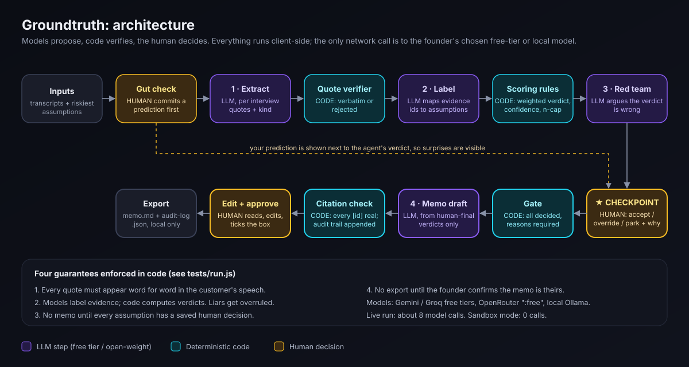

# Architecture

```mermaid
flowchart LR
  A[Transcripts + assumptions] --> G{{HUMAN: gut check}}
  G --> E[LLM: extract quotes]
  E --> V[CODE: verify verbatim]
  V --> L[LLM: label evidence per assumption]
  L --> S[CODE: weighted verdict + confidence]
  S --> R[LLM: red-team]
  R --> H{{HUMAN CHECKPOINT: accept / override / park + why}}
  G -.prediction shown beside verdict.-> H
  H --> GATE[CODE: gate - all decided, reasons present]
  GATE --> M[LLM: memo from human-final verdicts]
  M --> C[CODE: citation check + audit trail]
  C --> AP{{HUMAN: edit + approve}}
  AP --> X[Export memo.md + audit-log.json]
```

## Modules

| File | Responsibility | Touches network? |
|---|---|---|
| `js/core.js` | Transcript parsing, quote verifier, JSON repair, scoring, gate, prompts, pipeline | No |
| `js/llm.js` | OpenAI-compatible client, pacing, retry/backoff, free-tier guard | Only to the chosen provider |
| `js/sandbox.js` | Scripted provider for no-cost demo | No |
| `js/app.js` | UI state machine and rendering | No |

`core.js` takes a `provider.chat({task, system, user, json})` object, so any model (or the sandbox, or a test double) plugs in unchanged.

## Code-only analyses (no model calls)

| Analysis | Inputs | Output |
|---|---|---|
| Interview coach | parsed turns, verified evidence, leading questions | talk share, leading and future-tense questions, behaviour share, grade, tips |
| Robustness (leave-one-out) | verdict, weighted evidence per interviewee | stable, or which single interviewee flips it and to what |
| Calibration | locked predictions, computed verdicts | predictions matched by evidence |
| Citation check | memo text, evidence ids | unknown ids flagged live while editing |

## Sandbox design

Fixtures are keyed by interviewee name, not position, so removing an interview from a sample still resolves every evidence id correctly. Scripted prose that names a removed person is dropped rather than shown. Unknown transcripts are refused with a message pointing to Live mode.

## Failure handling

| Failure | Behaviour |
|---|---|
| Model returns invalid JSON | One automatic repair retry, then the interview is skipped and reported |
| Model fabricates or paraphrases a quote | Rejected by the verifier, counted and shown to the user |
| Model cites a non-existent evidence id | Ignored, counted, flagged on the card |
| Model's verdict disagrees with the rules | Rules win; disagreement is shown |
| Red-team call fails | Run continues; cards say the pass did not return |
| 429 / 5xx from a free tier | Honours `Retry-After`, exponential backoff, up to 4 retries |
| Memo cites an unknown id | Marked red, user warned before export |
